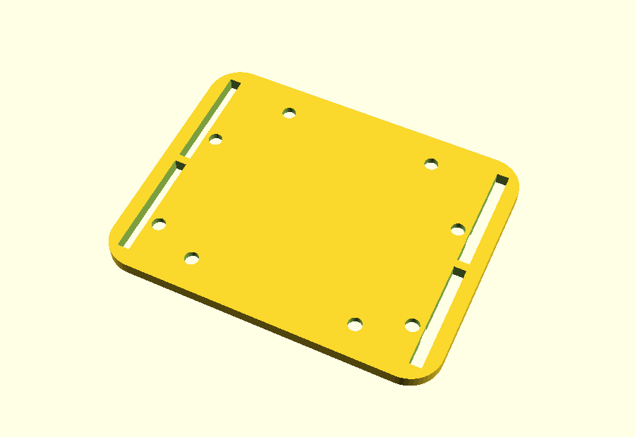

# Placa para prender o kit da IMU à mão

Placa de 82 × 64 × 3,2 mm que aparafusa ao kit pelos furos do Arduino Uno (os
mesmos parafusos M3 que já lá estão) e leva duas fitas de velcro de 25 mm, uma
em cada ponta. O lado liso encosta à mão ou à luva; as cabeças dos parafusos
ficam embutidas.

- `placa_mao.scad` — modelo paramétrico (OpenSCAD).
- `placa_mao.stl` — pronto a imprimir, com o lado da mão virado para a mesa.

Sugestão: usar nas **costas da mão**, com o cabo USB a sair para o pulso. Na
palma, a mão não fecha e o cabo fica no caminho.

Não testada em nada real: confirmar que os furos batem com o kit.
