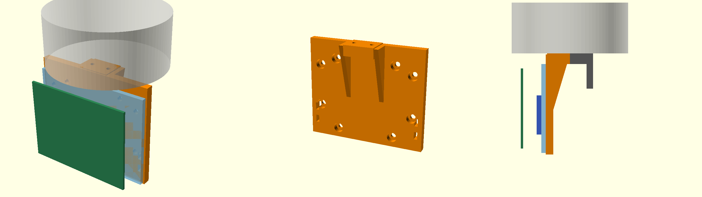

# Suporte da IMU para a pinça do Lite 6

Peça para imprimir em 3D que **substitui um dedo da pinça** e segura o kit do
laboratório (Arduino Uno + acrílico, com a IMU colada entre os dois).

- `suporte_imu.scad` — modelo paramétrico (OpenSCAD). Todas as medidas estão no topo do ficheiro.
- `suporte_imu.stl` — pronto a imprimir.
- `vistas.png` — a peça (laranja) com a pinça, o outro dedo e o kit à volta.

## Como se monta

1. Aparafusar o kit à parede da peça com os **mesmos parafusos M3 que já estão
   no kit** (os dos espaçadores, nos furos do Arduino). A cabeça entra numa
   caixa e fica só com 1,6 mm de plástico por baixo, por isso o parafuso perde
   1,6 mm de rosca no espaçador. A parede tem o padrão de furos do Uno e o seu
   espelho: serve com o kit virado para qualquer lado.
2. Tirar **um** dedo da pinça (2 parafusos M2,5, por baixo) e guardá-lo.
3. Aparafusar a peça no lugar do dedo, com **M2,5 × 5** (a peça tem 2 mm de
   plástico por baixo da cabeça; o dedo original tem 0,9 mm e usa M2,5 × 4).
   A rosca na corrediça só tem 3 mm de fundo: não usar parafusos mais compridos.
4. Prender o cabo USB com uma abraçadeira nos rasgos da parede, com folga.

No fim, voltar a montar o dedo original.

## Imprimir

Face de fora da parede (onde encosta o acrílico) na mesa. Sem suportes.
PLA ou PETG, 3 perímetros, 30 % de enchimento.

## Por confirmar antes de imprimir

- Autorização do professor para tirar um dedo da pinça.
- Que os parafusos dos dedos são M2,5 e entram por baixo (é o que o ficheiro do fabricante mostra).
- Se a pinça fica **fechada** quando está parada. A peça foi desenhada para isso: com a pinça aberta fica 8,1 mm mais para fora.
- Que os parafusos M3 do kit ainda apertam bem com menos 1,6 mm de rosca. Se não, baixar `m3_sob_cabeca` no `.scad` (mínimo razoável: 1,2 mm).
- A peça desce 67 mm abaixo do corpo da pinça e o kit fica de lado: as trajetórias do robô têm de contar com isso (a verificação de colisões do Lab 2 não o inclui).
