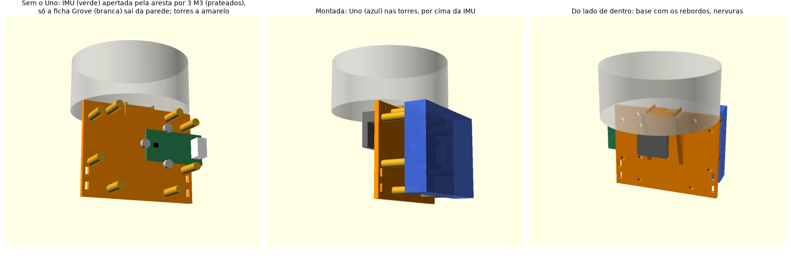

# Suporte da IMU para a pinça do Lite 6 (peça "1")

Peça para imprimir em 3D que **substitui um dedo da pinça** e segura o Arduino
Uno (sem o acrílico) e a placa Grove da IMU (ICM-20600, 40 × 20 mm), aparafusada pelos furos dela.

- `suporte_imu.scad`: modelo paramétrico (OpenSCAD). Todas as medidas estão no topo do ficheiro.
- `suporte_imu.stl`: pronto a imprimir.
- `suporte_imu.step`: a mesma peça em sólido (B-rep), para abrir e editar em CAD. Gerado por
  `suporte_imu_step.py` (CadQuery, num ambiente à parte), que refaz a peça com os mesmos
  parâmetros do `.scad`; se o `.scad` mudar, mudar também o script.
- `vistas.png`: a peça (laranja) com a pinça, a IMU, as torres e o Uno.

## Medidas

- Pinça: ficheiro STEP do fabricante (`../gripper_lite/MEDIDAS.md`), confirmado
  no laboratório a 16/11. Carro com 17 mm de largura; furos a 12 mm; o dedo
  abraça o carro com dois rebordos baixos e tem as cabeças dos parafusos
  rebaixadas (cerca de 0,9 mm de material debaixo da cabeça). A pinça parada está
  **aberta** (16 mm entre o carro e o outro dedo).
- Placa da IMU: ficheiro Eagle da Seeed (40 × 20 mm, chip a 6,16 mm da aresta
  curta do lado oposto à ficha) e medidas no laboratório (1,75 mm de placa,
  10 mm até ao topo da ficha Grove).
- Uno: torres de dois espaçadores com 16 mm, parafuso M3 de 6 mm e porca de 3 mm;
  14 mm de altura do Uno com as fichas.

## Como se monta

1. Prender a placa da IMU à parede, com o chip para fora, com 3 parafusos
   M3 × 10 e porca do lado de dentro (as porcas das torres do Uno ficam
   livres). Os parafusos passam por fora da placa e a cabeça aperta 1,2 mm da
   aresta: dois nas arestas compridas, um na aresta do lado do chip. Encostar
   a placa a este último antes de apertar. Uma anilha de cada lado ajuda. A
   placa fica debaixo do Uno e só a ponta com a ficha Grove sai para lá da
   aresta da parede (o cabo entra na perpendicular à placa).
2. Aparafusar o Uno pelas torres de 16 mm: o parafuso M3 de 6 mm entra pelo
   lado de dentro da parede (cabeça à vista) e ficam 3 mm de rosca na torre.
   A parede tem o padrão de furos do Uno e o seu espelho, por isso o Uno pode
   ir virado para qualquer lado.
3. Tirar **um** dedo da pinça (2 parafusos M2,5 × 4, por baixo) e guardá-lo.
4. Aparafusar a peça no lugar do dedo com os **mesmos parafusos**. Ficam 2,8 mm
   de rosca no carro, que só tem 3 mm de fundo: não usar parafusos mais
   compridos.
5. Prender o cabo USB com uma abraçadeira nos rasgos da parede, com folga.

No fim, voltar a montar o dedo original.

## Imprimir

Face de fora da parede (a da IMU e do Uno) na mesa. Parede de 74 × 59 × 3 mm. Sem suportes.
PLA ou PETG, 3 perímetros, 30 % de enchimento. O "1" fica gravado por baixo da base.

## Notas

- A posição do chip vem do desenho; a orientação dos eixos do chip é uma
  hipótese, confirmada pelo ensaio de poses no robô.
- `src/robo/geometria.py` põe este STL e uma caixa do tamanho do Uno no modelo
  MuJoCo, e `src/robo/verificar.py` procura colisões com eles.
- O STL é binário (`--export-format binstl`), porque o MuJoCo não lê STL em texto.
